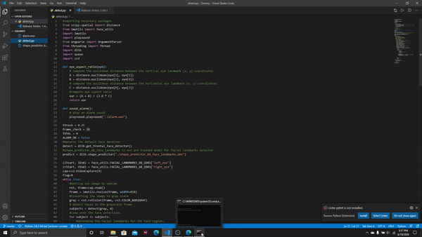
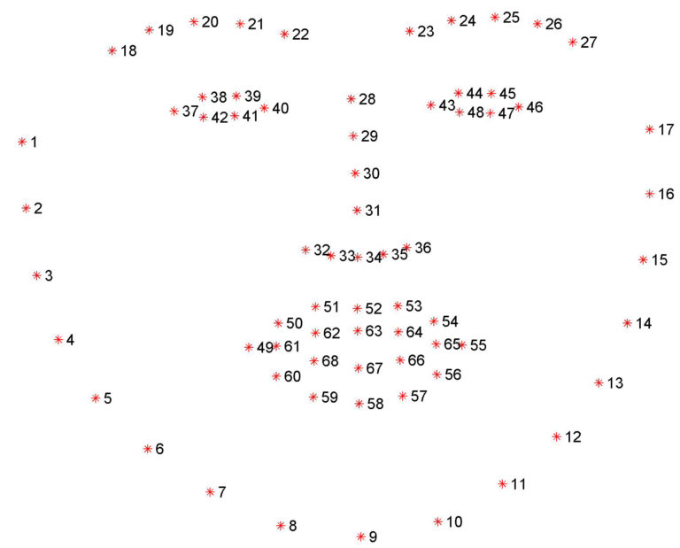
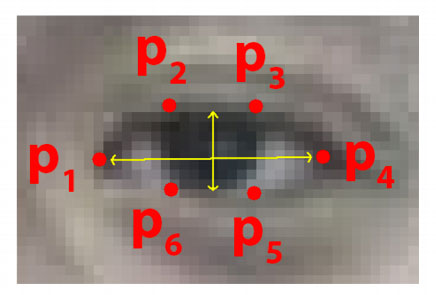
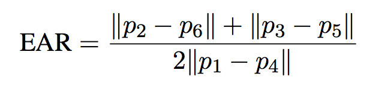
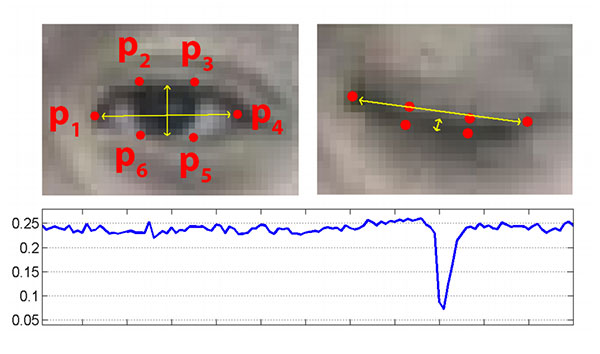

# Drowsiness Detection with Alert

> Driver fatigue is one of the biggest causes of road accidents.

A real-time computer vision system that watches a driver's eyes and mouth through a webcam. It sounds an alarm when they're falling asleep and warns them when they keep yawning.

<p align="center">
  
</p>

## Features
- **Drowsiness alarm:** sounds an alarm when the eyes stay closed too long
- **Yawn detection:** counts yawns and shows an on-screen warning
- **Blink counter**
- **Live dashboard:** EAR, MAR, blink/yawn/alert counts and FPS shown on the video
- **Driver focus:** if several faces are visible, only the largest (closest) one is tracked
- **CSV event log:** optionally saves every alert with a timestamp, for later analysis
- **Configurable from the command line:** thresholds, camera and model path
- **Session summary** printed when you quit
- **Unit tests** for the detection logic

## How it works

### 1. Facial landmarks
dlib's pre-trained 68-point landmark model finds the face. The points around each eye (36–47) and the inner mouth (60–67) are then extracted.

<p align="center">
  
</p>

### 2. Eye Aspect Ratio (EAR): drowsiness
```
EAR = (|p2 - p6| + |p3 - p5|) / (2 * |p1 - p4|)
```
When the eye is open, the EAR stays roughly constant. When the eye closes, it drops toward zero. The EAR of both eyes is averaged:
- Below **0.25** for a few frames: counted as a **blink**
- Below **0.25** for **20 frames in a row**: **DROWSINESS ALERT** and the alarm sounds

<p align="center">
  
  
</p>

### 3. Mouth Aspect Ratio (MAR): yawning
```
MAR = (|p61 - p67| + |p62 - p66| + |p63 - p65|) / (3 * |p60 - p64|)
```
A MAR above **0.6** for **15 frames in a row** counts as one **yawn**. Frequent yawning is an early sign of fatigue, so it shows up before the person actually falls asleep.

<p align="center">
  
</p>

## Tech stack
- Python 3
- OpenCV: webcam capture and on-screen display
- dlib: face detection and 68-point landmarks
- NumPy, SciPy: landmark maths
- playsound: alarm audio (falls back to `winsound` on Windows)

## Getting started

### 1. Install dependencies
```bash
pip install -r requirements.txt
```
> On Windows, installing `dlib` needs CMake and the Visual Studio C++ build tools. You can also install a prebuilt wheel.

### 2. Download the landmark model
The model file is about 100 MB, so it's not stored in this repo.
1. Download http://dlib.net/files/shape_predictor_68_face_landmarks.dat.bz2
2. Extract it and put `shape_predictor_68_face_landmarks.dat` next to `detect.py`

### 3. Run
```bash
python detect.py
```
Press **q** to quit.

Example with custom settings and a log file:
```bash
python detect.py --ear-thresh 0.22 --ear-frames 15 --log alerts.csv
```

## Options

| Option | Default | Meaning |
|---|---|---|
| `--camera` | `0` | Webcam index |
| `--ear-thresh` | `0.25` | EAR below this counts as eyes closed |
| `--ear-frames` | `20` | Closed-eye frames in a row before the drowsiness alarm |
| `--mar-thresh` | `0.6` | MAR above this counts as mouth wide open |
| `--yawn-frames` | `15` | Open-mouth frames in a row to count a yawn |
| `--log` | off | CSV file to save alerts to |
| `--model` | `./shape_predictor_68_face_landmarks.dat` | Landmark model path |
| `--alarm` | `./alarm.wav` | Alarm sound |
| `--width` | `640` | Processing width in pixels |

## Tests
```bash
pip install pytest
python -m pytest tests
```
The tests check the EAR and MAR maths and the blink, drowsiness and yawn logic. They don't need a camera or dlib.

## What I built on top of the original
This project started from an open-source EAR-based drowsiness detector. I extended it with:
- Yawn detection using the Mouth Aspect Ratio
- A blink counter, a live on-screen dashboard and a session summary
- A CSV event log and command-line options
- Tracking of only the largest face (the driver)
- A restructured `detect.py`: the detection logic is in a `FatigueMonitor` class that can be tested without a camera
- Unit tests
- Bug fixes:
  - The alarm thread was never set as a daemon because of a typo (`deamon`)
  - The alarm could start overlapping copies of itself
  - The program crashed when the camera returned no frame
  - The model and alarm paths only worked when run from the project folder
  - There was no clear error when the model file was missing

## Credits
- Original EAR drowsiness detector: an open-source project based on the PyImageSearch tutorial below
- Soukupová, T. & Čech, J. (2016). *Real-Time Eye Blink Detection using Facial Landmarks.* 21st Computer Vision Winter Workshop.
- [Drowsiness detection with OpenCV](https://www.pyimagesearch.com/2017/05/08/drowsiness-detection-opencv/) by Adrian Rosebrock, PyImageSearch
- [Eye blink detection algorithms](https://hackaday.io/project/27552-blinktotext/log/68360-eye-blink-detection-algorithms), Hackaday
- Facial landmark model: [dlib](http://dlib.net/) by Davis King
